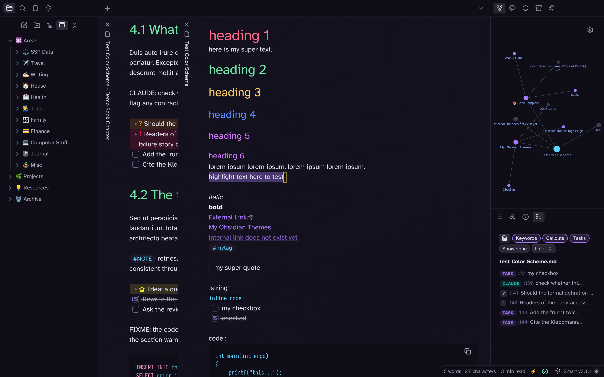
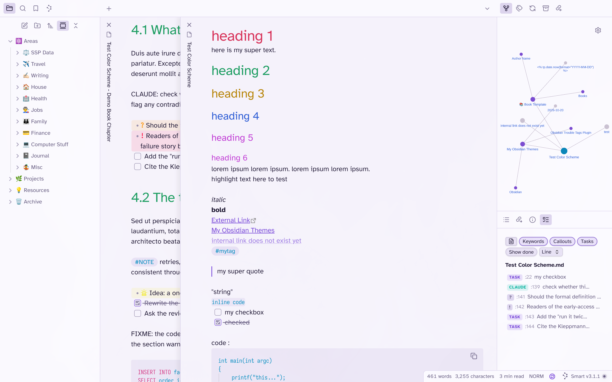
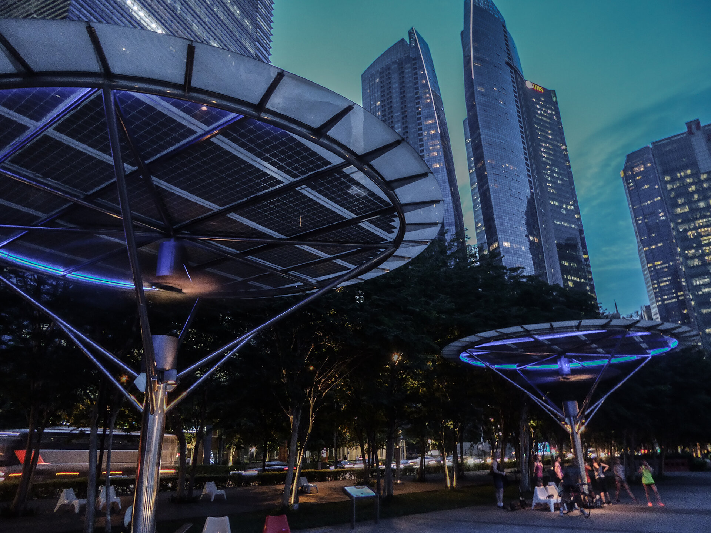
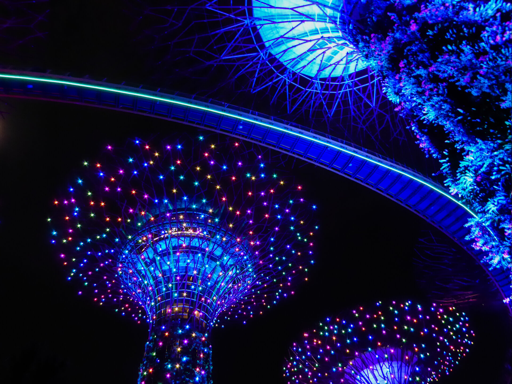

# Asia Neon (Obsidian Theme)
This is an **Asia Neon** (Singapore) theme for [Obsidian](https://obsidian.md/). The color palette is generated from my own night photos of Singapore (Gardens by the Bay, Marina Bay) and is the same palette I use for my [Omarchy](https://omarchy.org) theme [omarchy-asia-neon-theme](https://github.com/sspaeti/omarchy-asia-neon-theme). It supports dark and light mode.

Installation: Simply search `Asia Neon` in the Obsidian Community Themes and Install. Or if manually, copy the `theme.css` file to `.obsidian/themes/Asia Neon/` in your vault directory and reload Obsidian for it to take effect.

## Dark Mode


## Light Mode (Neon Day on lavender paper)


## Based on these Photos
The dark palette is extracted from these pictures, which I use as desktop backgrounds in Omarchy:


Main shot:

Second:


### Color Palette

| Role       | Dark      | Light     |
|------------|-----------|-----------|
| Background | `#14111f` | `#f6f3fc` |
| Foreground | `#e6e0f5` | `#2b2440` |
| Accent     | `#a67bff` | `#7c4ddb` |
| Red        | `#ff6b8a` | `#d9365d` |
| Yellow     | `#ffd166` | `#b8860b` |
| Orange     | `#ff9f5a` | `#d9711e` |
| Green      | `#6ee7a8` | `#1f9e63` |
| Cyan       | `#5cd8ff` | `#0a8fc2` |
| Blue       | `#5a8cff` | `#2f5fd6` |
| Magenta    | `#d67bff` | `#c23fd6` |

### Bump Version

```sh
npm run version
```

---

*Check also my other Theme I created, [Fireplace](https://github.com/sspaeti/obsidian_fireplace/), [Kanagawa](https://github.com/sspaeti/obsidian_kanagawa), [Kanagawa Paper](https://github.com/sspaeti/obsidian_kanagawa_paper/), [Rosé Pine](https://github.com/sspaeti/obsidian_rose_pine/), [Osaka Jade](https://github.com/sspaeti/obsidian_osaka_jade).*
